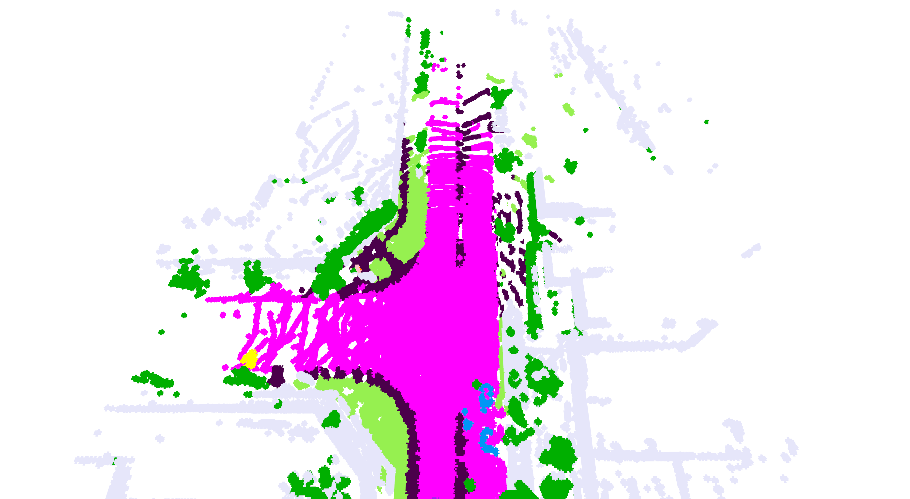
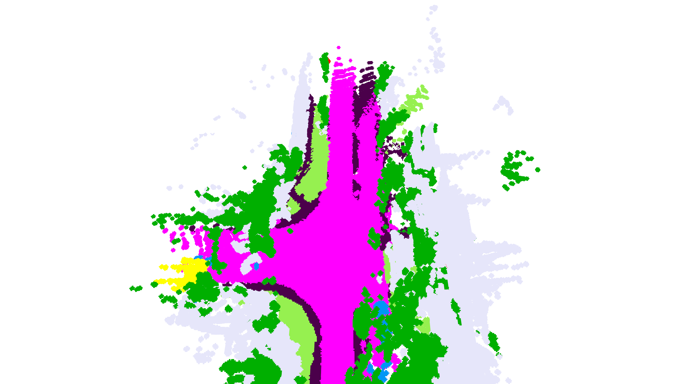

# TT-Occ: Test-Time Compute for Self-Supervised Occupancy

[](https://arxiv.org/abs/2503.08485)


**Why train a dedicated occupancy network in the era of foundation VLMs?**
We show that a test-time occupancy framework that integreted with a conmbination of VLMs could achieve SOTA performance **without any network training or fine-tuning**.

> TT-Occ easily integrates advanced VLMs through a simple adapter interface. Contributions are warmly welcomed!

## 📥 Data Preparation

1. Download the nuScenes dataset from [nuScenes.org](https://www.nuscenes.org/download).
2. Extract nuScenes data into a readable format:
   ```bash
   python extract_nuscenes.py --data-root /path/to/nuscenes \
       --save-root /path/to/new_extracted_nuscenes_val --split val
   ```
3. Download ground-truth occupancy labels:
   * Occ3D-nuScenes GT: [Google Drive](https://drive.google.com/drive/folders/1Xarc91cNCNN3h8Vum-REbI-f0UlSf5Fc)
   * nuCraft GT: [nuCraft GitHub](https://github.com/V2AI/nuCraft_API?tab=readme-ov-file)
4. Supply data, GT and output paths through the runtime environment variables below.

## 🌱 Environment Setup
For the external repositories used in this project, we provide minimal versions of their codebases under the `submodules` directory (with their original licenses retained; please respect and comply with their terms). These have been packaged under a unified conda environment, so you do not need to clone each dependency separately.

To reproduce our environment reliably, use:

```bash
conda env create -f environment.yaml
conda activate ttocc
bash submodules/install_and_download.sh
```

`install_and_download.sh` (run from the repo root, with `ttocc` activated) includes all install and checkpoint download steps required by TT-Occ (OpenSeeD / Rex-Omni / VGGT / MapAnything / RAFT / 3DGS CUDA extensions).

## ✅ Currently Supported Online Models

TT-Occ currently supports the following online test-time providers:

- Semantic models: `openseed`, `rexomni`
- Depth models: `vggt`, `mapanything`
- Dynamic mask model: `raft`

Selection is controlled by environment variables in `run_main.sh`:

- `SEMANTIC_PREFIX` (`rexomni` by default: Rex-Omni + SAM)
- `DEPTH_PREFIX` (`mapanything` by default)
- Camera dynamic masks use RAFT.

## 🚀 Running TT-Occ

Set the extracted nuScenes data, GT, dataset and output paths:

```bash
conda activate ttocc
DATA_ROOT=/path/to/new_extracted_nuscenes_val \
GT_PATH=/path/to/Occ3D_nuscenes/gts \
OCC_SETTING=Occ3D \
OUTPUT_ROOT=/path/to/run-output bash run_main.sh
```

For **nuCraft**, use `OCC_SETTING=nuCraft` and `GT_PATH=/path/to/nuCraft/occupancy@0.2`. Both datasets use the same extracted nuScenes input.

By default, the script runs both LiDAR and per-frame Camera. Set `VARIANTS=lidar` or `VARIANTS=camera_frame` to run one mode. Model selection is described above.

Results are saved under `OUTPUT_ROOT`; the aggregate metrics are in `metrics_full_precision.json`. Reuse the same output directory to resume an interrupted run with the same code and configuration.

## 📊 Results

Each configuration covers **150 scenes and 6019 frames**. Evaluation defaults to [Corrected](https://github.com/Xian-Bei/TT-Occ/issues/3), which retains prediction column 0. Paper deletes that column and is deprecated, retained only for comparison. Scene confusion matrices are summed before calculating the metrics.

### Occ3D

| Configuration | mIoU (Paper) | mIoU ([Corrected](https://github.com/Xian-Bei/TT-Occ/issues/3)) |
|---|---:|---:|
| LiDAR + Rex-Omni/SAM | 27.4% | 25.2% |
| LiDAR + OpenSeeD | 22.0% | 21.9% |
| Camera + Rex-Omni/SAM + MapAnything | 19.0% | 17.1% |
| Camera + OpenSeeD + VGGT | 12.8% | 12.8% |

### nuCraft

| Configuration | mIoU (Paper) | mIoU ([Corrected](https://github.com/Xian-Bei/TT-Occ/issues/3)) |
|---|---:|---:|
| LiDAR + Rex-Omni/SAM | 11.6% | 11.0% |
| LiDAR + OpenSeeD | 9.6% | 9.6% |
| Camera + Rex-Omni/SAM + MapAnything | 7.0% | 6.7% |
| Camera + OpenSeeD + VGGT | 4.1% | 4.1% |

## 🎨 Visualization

We provide a simple occupancy visualizer based on **Open3D**.
To visualize occupancy predictions, run:

```bash
python vis.py --data_path /path/to/new_extracted_nuscenes_val \
    --gt_path /path/to/Occ3D_nuscenes/gts --dataset Occ3D \
    --model-paths /path/to/run-output/predictions/LIDAR_rexomni
```

Example visualization outputs:

* **TT-OccLiDAR:**
  

* **TT-OccCamera:**
  

For advanced visualization commands, refer to `custom_utils/VoxelGridVisualizer`.


## 📌 Acknowledgements

This project builds upon the excellent codebase of [3DGS](https://github.com/graphdeco-inria/gaussian-splatting) and powerful VLMs including [OpenSeeD](https://github.com/IDEA-Research/OpenSeeD), [Rex-Omni](https://github.com/IDEA-Research/Rex-Omni), [VGGT](https://github.com/facebookresearch/vggt), [MapAnything](https://github.com/facebookresearch/map-anything), and [RAFT](https://github.com/princeton-vl/RAFT).
We deeply appreciate their creators' efforts and your interest in TT-Occ!

## 📖 Citation

If you find this work helpful, please star our repo and cite the paper:

```bibtex
@InProceedings{ttocc,
    author    = {Zhang, Fengyi and Sun, Xiangyu and Yang, Huitong and Zhang, Zheng and Huang, Zi and Luo, Yadan},
    title     = {Test-Time 3D Occupancy Prediction},
    booktitle = {Proceedings of the IEEE/CVF Conference on Computer Vision and Pattern Recognition (CVPR)},
    month     = {June},
    year      = {2026},
    pages     = {35691-35701}
}
```
