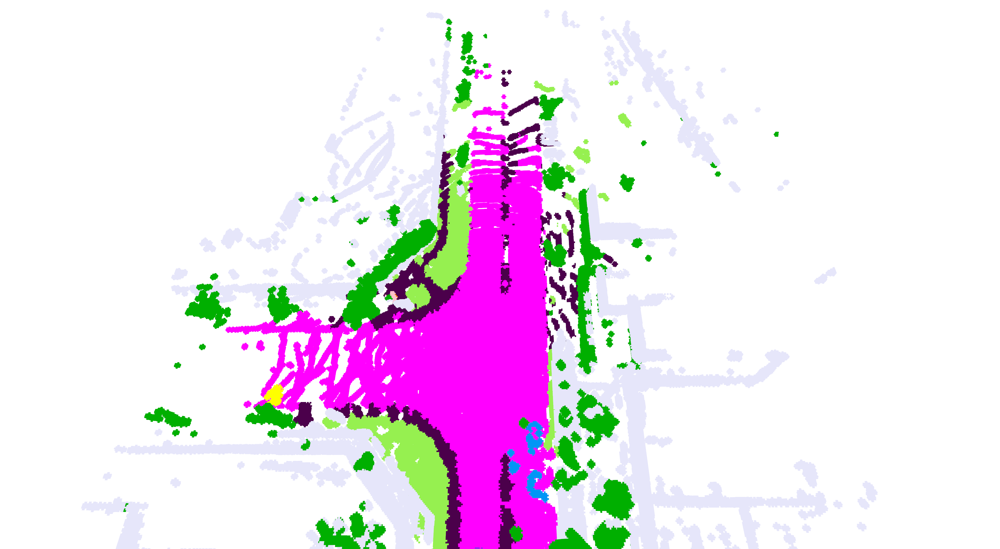
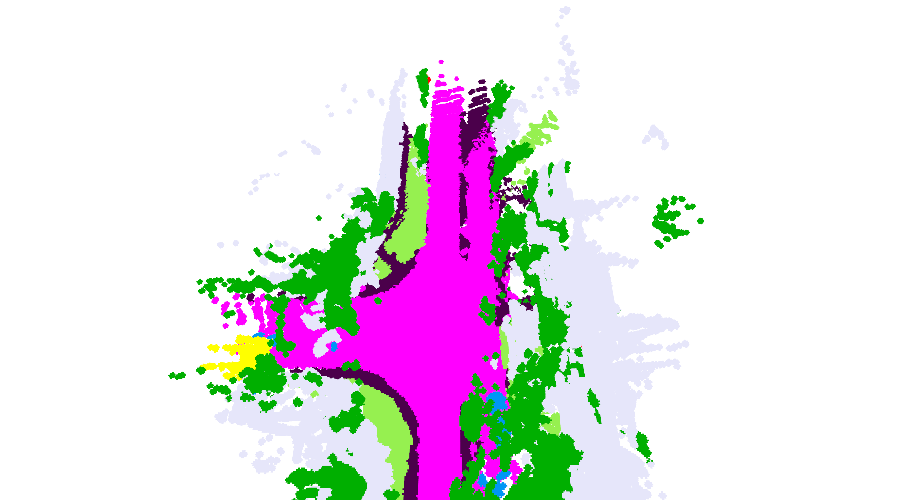

# TT-Occ: 面向自监督占据预测的测试时计算框架

[](https://arxiv.org/abs/2503.08485)

## 持续更新中


**在基础模型时代，为什么还要单独训练占据网络？**  
我们展示了一个测试时占据预测框架：通过组合多个 VLM，无需训练或微调即可达到 SOTA 表现。

> TT-Occ 通过统一适配接口支持多种先进 VLM，欢迎贡献！

## 📥 数据准备

1. 从 [nuScenes.org](https://www.nuscenes.org/download) 下载 nuScenes 数据集。
2. 将 nuScenes 提取为本项目可读格式：
   ```bash
   python extract_nuscenes.py --data-root /path/to/nuscenes \
       --save-root /path/to/new_extracted_nuscenes_val --split val
   ```
3. 下载占据真值标签：
   - Occ3D-nuScenes GT: [Google Drive](https://drive.google.com/drive/folders/1Xarc91cNCNN3h8Vum-REbI-f0UlSf5Fc)
   - nuCraft GT: [nuCraft GitHub](https://github.com/V2AI/nuCraft_API?tab=readme-ov-file)
4. 运行时通过环境变量指定数据、GT 和输出路径。

## 🌱 环境安装

项目依赖的外部代码均提供在 `submodules` 下（保留原始许可证，请遵守相应条款），并统一到同一个 conda 环境中。

建议按下面流程安装：

```bash
conda env create -f environment.yaml
conda activate ttocc
bash submodules/install_and_download.sh
```

`submodules/install_and_download.sh`（在仓库根目录执行，且已激活 `ttocc`）已包含完整流程：安装依赖并下载所需 checkpoint（OpenSeeD / Rex-Omni / VGGT / MapAnything / RAFT / 3DGS CUDA 扩展）。

## ✅ 当前已支持的在线模型

TT-Occ 当前支持以下在线 test-time provider：

- 语义模型：`openseed`, `rexomni`
- 深度模型：`vggt`, `mapanything`
- 动态掩码模型：`raft`

在 `run_main.sh` 中通过环境变量选择：

- `SEMANTIC_PREFIX`（默认 `rexomni`，即 Rex-Omni + SAM）
- `DEPTH_PREFIX`（默认 `mapanything`）
- Camera 动态掩码使用 RAFT。

## 🚀 运行 TT-Occ

指定提取后的 nuScenes 数据、GT、数据集和输出路径：

```bash
conda activate ttocc
DATA_ROOT=/path/to/new_extracted_nuscenes_val \
GT_PATH=/path/to/Occ3D_nuscenes/gts \
OCC_SETTING=Occ3D \
OUTPUT_ROOT=/path/to/run-output bash run_main.sh
```

评测 **nuCraft** 时，设置 `OCC_SETTING=nuCraft` 和 `GT_PATH=/path/to/nuCraft/occupancy@0.2`。两个数据集共用同一份提取后的 nuScenes 输入。

默认运行 LiDAR 和逐帧 Camera。可设置 `VARIANTS=lidar` 或 `VARIANTS=camera_frame` 单独运行一种模式；模型选择见上文。

结果保存在 `OUTPUT_ROOT` 中，汇总指标为 `metrics_full_precision.json`。代码和配置相同时，使用同一输出目录可断点续跑。

## 📊 评测结果

每个组合均覆盖 **150 场景、6019 帧**。两列均为 mIoU：(Paper) 删除预测第 0 列，(corrected) 保留该列；先累加场景混淆矩阵，再计算指标。

### Occ3D

| 组合 | mIoU (Paper) | mIoU (corrected) |
|---|---:|---:|
| LiDAR + Rex-Omni/SAM | 27.4% | 25.2% |
| LiDAR + OpenSeeD | 22.0% | 21.9% |
| Camera + Rex-Omni/SAM + MapAnything | 19.0% | 17.1% |
| Camera + OpenSeeD + VGGT | 12.8% | 12.8% |

### nuCraft

| 组合 | mIoU (Paper) | mIoU (corrected) |
|---|---:|---:|
| LiDAR + Rex-Omni/SAM | 11.6% | 11.0% |
| LiDAR + OpenSeeD | 9.6% | 9.6% |
| Camera + Rex-Omni/SAM + MapAnything | 7.0% | 6.7% |
| Camera + OpenSeeD + VGGT | 4.1% | 4.1% |

完整精度数值见 [RESULTS.csv](RESULTS.csv)。

## 🎨 可视化

项目提供基于 **Open3D** 的占据可视化：

```bash
python vis.py --data_path /path/to/new_extracted_nuscenes_val \
    --gt_path /path/to/Occ3D_nuscenes/gts --dataset Occ3D \
    --model-paths /path/to/run-output/predictions/LIDAR_rexomni
```

示例效果：

- **TT-OccLiDAR:**
  

- **TT-OccCamera:**
  

更多可视化能力请参考 `custom_utils/VoxelGridVisualizer`。

## 📌 致谢

本项目基于 [3DGS](https://github.com/graphdeco-inria/gaussian-splatting) 以及多种优秀 VLM，包括 [OpenSeeD](https://github.com/IDEA-Research/OpenSeeD)、[Rex-Omni](https://github.com/IDEA-Research/Rex-Omni)、[VGGT](https://github.com/facebookresearch/vggt)、[MapAnything](https://github.com/facebookresearch/map-anything)、[RAFT](https://github.com/princeton-vl/RAFT) 和 [TT-Occ](./)。  
感谢原作者团队，也感谢你对 TT-Occ 的关注！

## 📖 引用

如果该工作对你有帮助，欢迎 star 并引用：

```bibtex
@InProceedings{ttocc,
    author    = {Zhang, Fengyi and Sun, Xiangyu and Yang, Huitong and Zhang, Zheng and Huang, Zi and Luo, Yadan},
    title     = {Test-Time 3D Occupancy Prediction},
    booktitle = {Proceedings of the IEEE/CVF Conference on Computer Vision and Pattern Recognition (CVPR)},
    month     = {June},
    year      = {2026},
    pages     = {35691-35701}
}
```
